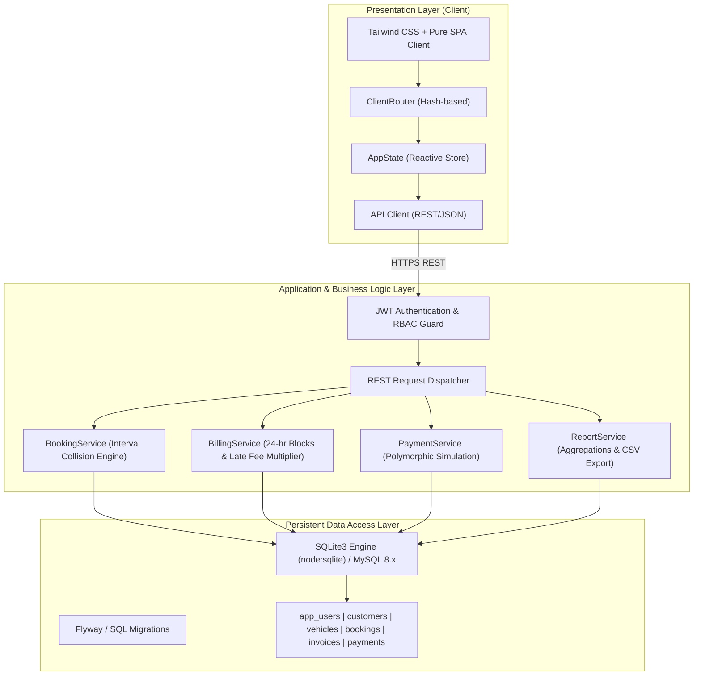
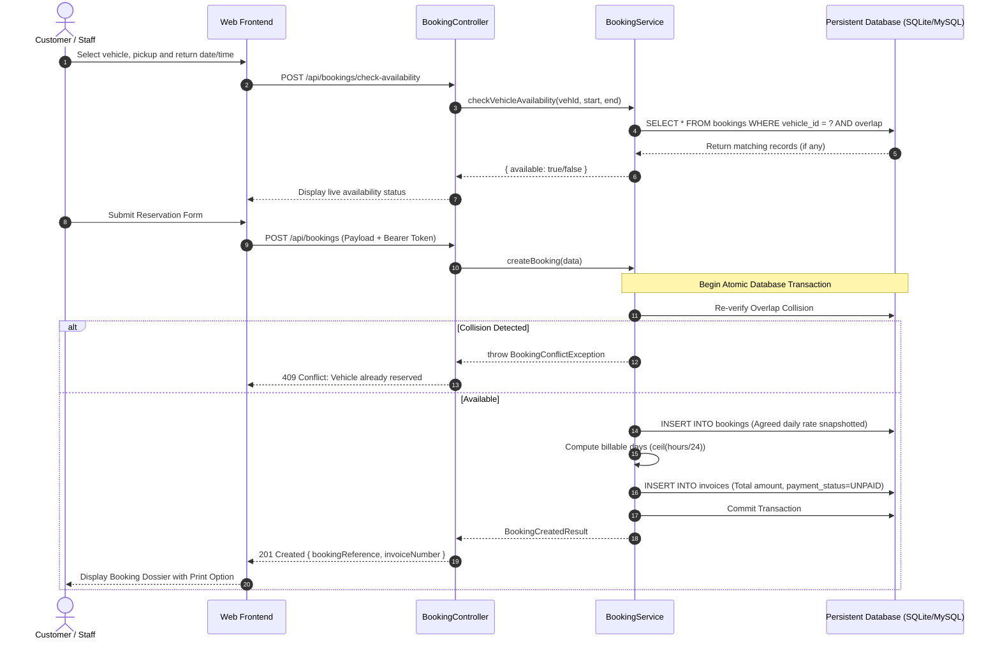
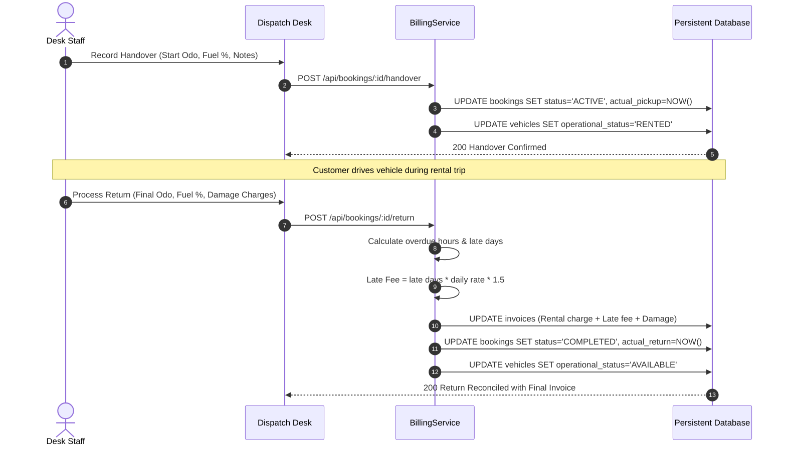

# FleetDesk — System Architecture & Component Design

## 1. High-Level Architectural Diagram

## 2. Sequence Diagram: Booking Creation & Collision Revalidation

## 3. Sequence Diagram: Vehicle Handover and Check-in Return

