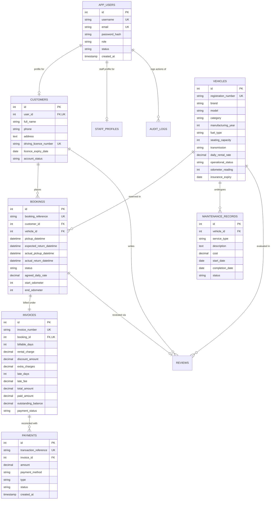

# FleetDesk — Database Entity Relationship Diagram (ERD)

## 1. Entity Relationship Diagram

## 2. Relational Schema Data Dictionary

| Table | Column | Type | Constraints | Description |
| :--- | :--- | :--- | :--- | :--- |
| `app_users` | `id` | INTEGER | PK, AUTO_INCREMENT | System user identifier |
| | `username` | VARCHAR(100) | UNIQUE, NOT NULL | Authentication username |
| | `email` | VARCHAR(150) | UNIQUE, NOT NULL | User email address |
| | `password_hash`| VARCHAR(255) | NOT NULL | PBKDF2/BCrypt salted hash |
| | `role` | VARCHAR(20) | CHECK IN (ADMIN, STAFF, CUSTOMER) | Role for RBAC authorization |
| `vehicles` | `id` | INTEGER | PK, AUTO_INCREMENT | Unique vehicle inventory ID |
| | `registration_number` | VARCHAR(50) | UNIQUE, NOT NULL | Regional RTO registration (e.g. KL-07-CD-1001) |
| | `category` | VARCHAR(30) | CHECK IN (CAR, BIKE, SUV, ELECTRIC_VEHICLE) | Vehicle classification |
| | `daily_rental_rate` | DECIMAL(10,2)| NOT NULL, > 0 | Baseline daily rental tariff |
| | `operational_status`| VARCHAR(30) | CHECK IN (AVAILABLE, RENTED, MAINTENANCE, DEACTIVATED) | Telematics operational status |
| `bookings` | `id` | INTEGER | PK, AUTO_INCREMENT | Reservation primary key |
| | `booking_reference` | VARCHAR(50) | UNIQUE, NOT NULL | Human-readable tracking reference (e.g. BK-2026-0001) |
| | `customer_id`| INTEGER | FK -> customers(id) | Associated customer |
| | `vehicle_id` | INTEGER | FK -> vehicles(id) | Associated fleet vehicle |
| | `agreed_daily_rate` | DECIMAL(10,2)| NOT NULL | Snapshotted rate preventing retrospective price changes |
| | `status` | VARCHAR(20) | CHECK IN (PENDING, CONFIRMED, ACTIVE, CANCELLED, COMPLETED, OVERDUE) | Current booking lifecycle state |
| `invoices` | `id` | INTEGER | PK, AUTO_INCREMENT | Invoice primary key |
| | `invoice_number` | VARCHAR(50) | UNIQUE, NOT NULL | Invoicing document code (e.g. INV-2026-0001) |
| | `late_days` | INTEGER | DEFAULT 0 | Ceiling of overdue hours / 24 |
| | `late_fee` | DECIMAL(10,2)| DEFAULT 0.00 | Calculated using configured 1.5x penalty multiplier |
| | `payment_status` | VARCHAR(20) | CHECK IN (UNPAID, PARTIALLY_PAID, PAID, REFUNDED, CANCELLED) | Commercial balance settlement status |
